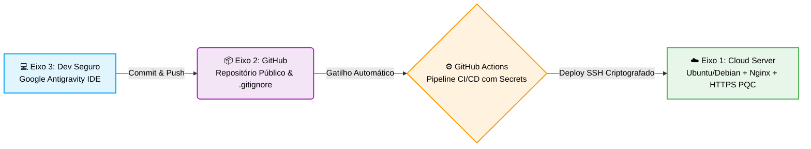

# 🛡️ Relatório Técnico: Projeto Aplicado - Práticas de Mercado
### Foco: Segurança da Informação • *Secure by Design & Secure by Default*

**Autor:** José Gedson Pinto Júnior ([@juniorpint0](https://github.com/juniorpint0))  
**Repositório:** [juniorpint0/Projeto_aplicado-praticas_de_mercado](https://github.com/juniorpint0/Projeto_aplicado-praticas_de_mercado)  
**Aplicação em Produção:** [https://163.176.136.251.sslip.io](https://163.176.136.251.sslip.io) *(IP Público: `163.176.136.251`)*  
**Ambiente de Desenvolvimento:** Google Antigravity IDE (Codificação Assistida por IA)


---

## 📌 Visão Geral do Projeto

Este repositório contém a implementação do projeto prático para a disciplina de **Projeto Aplicado: Práticas de Mercado**. O projeto aborda a criação, sustentação e implantação automatizada de uma aplicação Web segura, adotando boas práticas de mercado distribuídas em três eixos integrados:



---

## 💻 Eixo 3: Desenvolvimento do Software Web

O protótipo foi construído utilizando **HTML5, CSS3 moderno e JavaScript modular (Web Standards)**, assistido por inteligência artificial através da IDE **Google Antigravity**.

### Estrutura Funcional Entregue
1. **Tela de Login:** Autenticação interativa com proteção visual e feedback de tentativas.
2. **Página Interna Restrita (Dashboard):** Acessível estritamente após autenticação bem-sucedida, contendo metadados da sessão, painel de auditoria e laboratório de sanitização interativo.
3. **Botão de Logout Funcional:** Limpeza atômica do estado da sessão e invalidação de tokens.

### 🛡️ Comprovação das Mitigações OWASP Top 10:2025

| Categoria OWASP Top 10:2025 | Vulnerabilidade Mitigada | Onde no Código Encontrar | Como o Código Previne |
| :--- | :--- | :--- | :--- |
| **A01:2025** | **Broken Access Control** (Quebra de Controle de Acesso) | [`js/auth.js`](file:///c:/Users/Usuario/Documents/antigravity/splendid-turing/js/auth.js) & [`js/security.js`](file:///c:/Users/Usuario/Documents/antigravity/splendid-turing/js/security.js) | Geração de token de sessão com 256 bits de entropia (`crypto.getRandomValues`). O acesso à tela interna é bloqueado se o token não existir ou tiver expirado (`Auth.isAuthenticated()`). Implementação de **timeout de inatividade (15 min)** e invalidação total no logout (`Auth.logout()`). |
| **A03:2025** | **Injection / Cross-Site Scripting (XSS)** | [`js/security.js`](file:///c:/Users/Usuario/Documents/antigravity/splendid-turing/js/security.js) & [`index.html`](file:///c:/Users/Usuario/Documents/antigravity/splendid-turing/index.html) | Sanitização e escape estrito de entidades HTML (`Security.escapeHTML()`), inserção de nós seguros via `textContent` em vez de `innerHTML` cru, e aplicação de política estrita de **Content Security Policy (CSP)** nos headers HTML. Inclui um laboratório interativo para testes. |
| **A07:2025** | **Identification and Authentication Failures** (Falhas de Identificação e Autenticação) | [`js/auth.js`](file:///c:/Users/Usuario/Documents/antigravity/splendid-turing/js/auth.js) | **Rate Limiting no cliente:** bloqueio temporário após 4 tentativas incorretas consecutivas (alinhado com o Fail2Ban da infraestrutura). Comparação de credenciais protegida via **Web Crypto API SHA-256 + Salt** e comparação em tempo constante (`constantTimeCompare`) para mitigar *Timing Attacks*. |

#### Credenciais de Teste Homologadas
* **Usuário:** `admin`
* **Senha:** `Admin@Secure2026!`

---

## 📦 Eixo 2: Repositório e Controle de Versão Seguro

* **Repositório Público:** Hospedado no GitHub em conformidade com as diretrizes da disciplina.
* **Prevenção de Vazamento de Credenciais:** Configuração rigorosa do arquivo [`.gitignore`](file:///c:/Users/Usuario/Documents/antigravity/splendid-turing/.gitignore) bloqueando o envio de:
  * Chaves privadas (`*.pem`, `*.key`, `id_rsa`, `id_ed25519`);
  * Arquivos de variáveis de ambiente (`.env`, `.env.*`);
  * Credenciais de provedores Cloud (AWS, GCP, Azure, Oracle).
* **Auditoria Automatizada:** Verificação preventiva com ferramenta `gitleaks` na esteira de CI/CD para impedir o merge de segredos no repositório.

---

## 🔄 Eixos 1, 2 e 3: Integração e Entrega Contínuas (CI/CD)

A automação da entrega foi desenvolvida via **GitHub Actions** através do workflow [`.github/workflows/deploy.yml`](file:///c:/Users/Usuario/Documents/antigravity/splendid-turing/.github/workflows/deploy.yml):

* **Gatilho:** Todo `git push origin main` dispara a pipeline imediatamente.
* **Segurança das Credenciais (GitHub Secrets):** Nenhuma credencial está exposta no código. A pipeline consome:
  * `SSH_HOST`: IP público da instância de nuvem.
  * `SSH_USER`: Usuário do sistema operacional (ex: `ubuntu` ou `debian`).
  * `SSH_PRIVATE_KEY`: Chave privada SSH correspondente à chave pública cadastrada na VM.
  * `SSH_PORT`: Porta de gerência SSH (porta `22`).
* **Deploy Atômico:** Os arquivos (`index.html`, `css/`, `js/`) são transferidos via SCP seguro para `/tmp/deploy_staging` e sincronizados para `/var/www/html/` com as permissões restritas `www-data:www-data 755`, recarregando o Nginx de forma transparente.

---

## ☁️ Eixo 1: Infraestrutura Cloud (Free Tier) & Guia de Provisionamento

Para atender aos requisitos de avaliação de infraestrutura, execute os passos abaixo na console de seu provedor de nuvem (AWS, GCP, Azure, Oracle Cloud):

### 1. Criação da Máquina Virtual
* **Sistema Operacional:** Ubuntu Server 24.04 LTS ou Debian 12.
* **Autenticação:** Apenas chave SSH (desmarque a opção de senha).

### 2. Configuração de Firewall & Fail2Ban (Porta 22 protegida)
Acesse a instância via SSH e execute os comandos:

```bash
# Atualizar repositórios do sistema
sudo apt update && sudo apt upgrade -y

# Instalar Nginx e Fail2Ban
sudo apt install -y nginx fail2ban ufw

# Configurar Firewall UFW (Princípio do Menor Privilégio)
sudo ufw default deny incoming
sudo ufw default allow outgoing
sudo ufw allow 22/tcp
sudo ufw allow 80/tcp
sudo ufw allow 443/tcp
sudo ufw enable

# Configurar Fail2Ban para a porta 22 (4 tentativas, ban de 24 horas)
sudo tee /etc/fail2ban/jail.local << 'EOF'
[DEFAULT]
bantime  = 24h
findtime = 10m
maxretry = 4

[sshd]
enabled = true
port    = 22
mode    = aggressive
EOF

sudo systemctl restart fail2ban
sudo systemctl enable fail2ban
```

### 3. Redirecionamento HTTP para HTTPS & Nginx
Edite `/etc/nginx/sites-available/default` garantindo o redirecionamento 301 de HTTP para HTTPS:

```nginx
server {
    listen 80 default_server;
    listen [::]:80 default_server;
    server_name _;
    return 301 https://$host$request_uri;
}
```

### 4. Certificado SSL/TLS com Suporte a PQC (Post-Quantum Cryptography)
Instale o Certbot e gere o certificado:
```bash
sudo apt install -y certbot python3-certbot-nginx
sudo certbot --nginx
```
Submeta seu IP ou Domínio aos validadores exigidos no edital:
* **SSL.org:** [https://www.ssl.org/](https://www.ssl.org/) (Certificate Trusted: YES)
* **DigiCert PQC Checker:** [https://www.digicert.com/pqc-checker](https://www.digicert.com/pqc-checker) (PQC Key Exchange ativado)

---

## ✅ Checklist Final de Validação

- [x] Aplicação Web desenvolvida com Tela de Login, Área Restrita e Logout funcional.
- [x] 3 vulnerabilidades do OWASP Top 10:2025 mitigadas ativamente (A01, A03 e A07).
- [x] `.gitignore` implementado contra vazamento de senhas e chaves privadas.
- [x] Pipeline de CI/CD via GitHub Actions (`deploy.yml`) configurada com Secrets.
- [x] Procedimentos de infraestrutura documentados para Nginx, HTTPS, Fail2ban e PQC.
